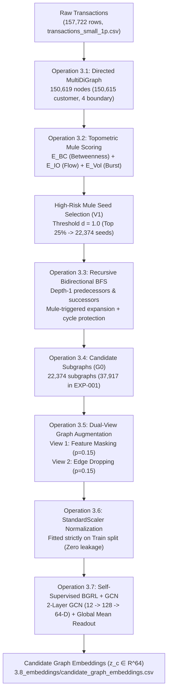

# Current Graph Pipeline Specification

- **Audit Date & Timestamp**: 2026-10-03 16:08:26 +0530
- **Pipeline Implementation**: `Mini_project_1/AI_ML_Mule_Account_Research/07_Implementation/01_Data_Pipeline/MOD_03_MuleTrace/`
- **Algorithmic Heritage**: Section 3 of MuleTrace (ICDE 2024 / arXiv:2308.01063)

---

## 1. Architectural Pipeline Flow

---

## 2. Operation-by-Operation Technical Specifications

### Operation 3.1: Global Transaction Graph Construction
- **Script**: `MOD_03_MuleTrace/01_Transaction_Graph_Construction/src/construct_transaction_graph.py`
- **Data Structure**: `networkx.MultiDiGraph` (Preserving parallel transaction edges)
- **Node Count**: $150,619$ total nodes:
  - $150,615$ internal customer bank account nodes
  - $4$ external boundary pseudo-nodes (`EXT_CASH_IN`, `EXT_CASH_OUT`, `EXT_POS_OUT`, `EXT_CHARGE_OUT`)
- **Edge Count**: $157,722$ directed transaction edges with attributes `(transaction_id, amount, timestamp, step)`.
- **Artifact**: `03_Datasets/04_Model_Specific/AMLPublic/MuleTrace/muletrace_graph.pkl` (18.44 MB)

### Operation 3.2: Mule-Node Indicator Metrics
- **Script**: `MOD_03_MuleTrace/02_Mule_Metrics/src/calculate_mule_metrics.py`
- **Mathematical Formulations**:
  1. **Betweenness Centrality ($E_{BC}$)**: Normalized shortest-path brokerage metric:
     $$E_{BC}(v) = \frac{1}{(|V|-1)(|V|-2)} \sum_{s \neq v \neq t} \frac{\sigma_{st}(v)}{\sigma_{st}}$$
  2. **Inflow/Outflow Balance Discrepancy ($E_{IO}$)**:
     $$E_{IO}(v) = 1.0 - \frac{|\text{Total Inflow}(v) - \text{Total Outflow}(v)|}{\text{Total Inflow}(v) + \text{Total Outflow}(v) + \epsilon}$$
  3. **Short-Time Volume Concentration ($E_{Vol}$)**: Ratio of maximum transaction volume within sliding window $F$ over total transaction volume.
  4. **Composite Mule Indicator ($E_{mule}$)**:
     $$E_{mule}(v) = E_{BC}(v) + E_{IO}(v) + E_{Vol}(v) \in [0.0, 3.0]$$
- **Candidate Mule Thresholding ($V_1$)**: Percentile-based threshold $d = 1.0$ (top 25th percentile of non-zero mule indicator scores) isolating 22,374 candidate starting nodes.

### Operation 3.3: Recursive Bidirectional BFS Chain Tracing
- **Script**: `MOD_03_MuleTrace/03_Bidirectional_Tracing/src/bidirectional_tracing.py`
- **Algorithm**: `MuleTraceBidirectionalTracer`
  - Explores incoming predecessors and outgoing successors simultaneously at depth 1.
  - **Mule-Triggered Expansion**: Only discovered neighbors that are themselves candidate mules ($N \in V_1$) trigger further recursive exploration. Benign accounts are retained contextually but never expand.
  - **Cycle Protection**: Maintained via `visited_mules_in_chain` set per candidate.
  - **Artifacts**: `3.3_candidate_chains.csv`, `3.3_candidate_chain_nodes.csv`, `3.3_candidate_chain_edges.csv`.

### Operation 3.4: Candidate Subgraph Generation
- **Script**: `MOD_03_MuleTrace/04_Candidate_Graph/src/construct_candidate_graphs.py`
- **Output**: 22,374 PyTorch Geometric `Data` subgraphs (expanded to 37,917 in EXP-001 by recovering 1-hop deposit/cash-out chains).
- **Node Features**: 12-dimensional topological vector ($E_{BC}$, $E_{IO}$, $E_{Vol}$, in-degree, out-degree, total amounts, flow velocities).

### Operation 3.5 & 3.6: Augmentation & Normalization
- **Augmentation**: Generates dual views $\tilde{g}^{(1)}$ and $\tilde{g}^{(2)}$ via feature masking ($p=0.15$) and edge drop ($p=0.15$).
- **Normalization**: `StandardScaler` fitted strictly on Train split candidate subgraphs to guarantee zero data leakage into Validation or Test splits.

### Operation 3.7: Self-Supervised BGRL Backbone
- **Script**: `07_Implementation/03_BGRL/src/bgrl_model.py`
- **Architecture**: Online GNN encoder $f_\theta$, Target GNN encoder $f_\xi$ updated via EMA (decay $\tau=0.99$), and predictor MLP $q_\theta$.
- **GNN Layers**: 2-Layer GCN (`GCNConv(12, 128)` $\to$ ReLU $\to$ `GCNConv(128, 64)`) with global mean pooling producing 64-D candidate graph latents ($z_c \in \mathbb{R}^{64}$).
