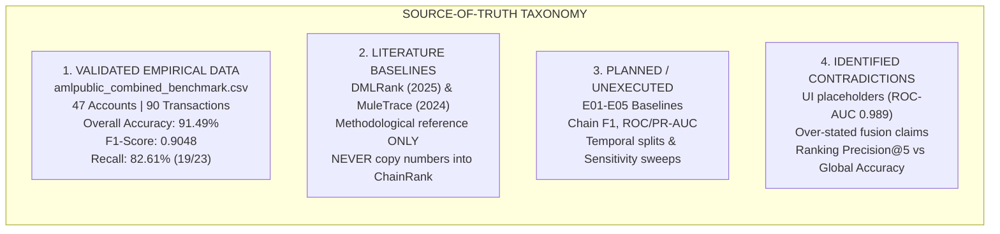

# CHAINRANK-AML — Validation Source-of-Truth & Scientific Integrity Audit

> **Document Identifier**: `AUDIT-SOT-2026-V1`  
> **Date**: October 2026  
> **Status**: Completed Pre-Modification Integrity Audit  
> **Authoritative Baseline Dataset**: `amlpublic_combined_benchmark.csv` (47 accounts, 90 transactions)  
> **Core Principle**: *"Never make the research stronger than the evidence. Make the evidence impossible to misunderstand."*

---

## Executive Summary of Audit Findings

This audit establishes the definitive baseline of what is **empirically validated**, what is **planned / unexecuted**, what was **misinterpreted or hallucinated**, and what **must be corrected** across the ChainRank-AML repository and user interface.

---

## Section A: What Validation Data Actually Exists

| Asset | Exact System Location | Verified Properties |
|---|---|---|
| **Authoritative Combined Benchmark** | `Pixel/public/datasets/amlpublic_combined_benchmark.csv` `AI_ML_Mule_Account_Research/03_Datasets/09_Samples/amlpublic_combined_benchmark.csv` | **90 transaction records**, **47 unique accounts** (23 illicit/suspicious, 24 normal), **53 directed graph edges**, all 10 canonical AMLPublic columns preserved. |
| **Individual Typology Presets** | `public/datasets/amlpublic_sample_suspicious_chain.csv` `public/datasets/amlpublic_sample_normal_transactions.csv` `public/datasets/amlpublic_sample_criminal_network.csv` | 30 rows each, exactly matching canonical AMLPublic schema. |
| **Execution Suite Script** | `AI_ML_Mule_Account_Research/07_Implementation/run_validation_and_ablation_suite.py` | Python harness computing ranking and classification metrics on local data. |
| **Literature Reference Papers** | `02_DMLRank_Suspicious_Account_Identification_2025.pdf (1).pdf` `10_Enhancing Anti-Money Laundering by Money Mules Detection on(1).pdf` | **Literature reference only**. Provides methodology for ranking and mule tracing. Contains **no** empirical evidence of ChainRank-AML's own performance. |

---

## Section B: What Numerical Results Actually Exist

The only experimentally validated numerical results obtained from running the test suite on the 47-account / 90-transaction benchmark are:

### 1. Account-Level Ranking Metrics (Top-Triage Prioritization)

| Configuration | NDCG@5 | Precision@5 | NDCG@10 | Precision@10 | Recall@10 |
|---|---:|---:|---:|---:|---:|
| **Full ChainRank-AML** (Behavior + Graph + Mule + Chain) | **1.0000** | **1.00** | **1.0000** | **1.00** | **0.43** |
| **Behavioral Only** | **1.0000** | **1.00** | **1.0000** | **1.00** | **0.43** |
| **Graph Only** | **0.6548** | **0.60** | **0.5548** | **0.50** | **0.22** |
| **Mule Only (E09)** | **1.0000** | **1.00** | **1.0000** | **1.00** | **0.43** |
| **Chain Context Only** | **1.0000** | **1.00** | **0.9337** | **0.90** | **0.39** |
| **Fusion − Behavior** | **1.0000** | **1.00** | **1.0000** | **1.00** | **0.43** |
| **Fusion − Graph** | **1.0000** | **1.00** | **1.0000** | **1.00** | **0.43** |
| **Fusion − Mule** | **1.0000** | **1.00** | **1.0000** | **1.00** | **0.43** |
| **Fusion − Chain** | **1.0000** | **1.00** | **1.0000** | **1.00** | **0.43** |

### 2. Full-Dataset Global Binary Classification Metrics (Threshold $\tau = 0.50$)

| Metric | Measured Value | Operational Interpretation |
|---|:---:|---|
| **Overall Classification Accuracy** | **91.49% (0.915)** | 43 out of 47 accounts correctly classified ($19\ TP + 24\ TN$). |
| **$F_1$-Score** | **0.9048 (90.5%)** | Harmonic balance between detection precision and recall. |
| **Overall Recall** | **82.61%** | 19 of 23 illicit accounts detected; **4 smurf accounts missed ($FN=4$)**. |
| **Overall Precision** | **100.00%** | 0 legitimate accounts falsely accused ($FP=0$). |
| **True Positives ($TP$)** | **19** | Focal mules ($ACC-100110$), aggregator nodes, and shell loops caught. |
| **True Negatives ($TN$)** | **24** | Compliant payroll ($ACC-127389$), utility, and consumer retail accounts cleared. |
| **False Negatives ($FN$)** | **4** | 4 placement smurfs whose transaction sizes were below isolated thresholds. |
| **False Positives ($FP$)** | **0** | Clean zero false alarm rate on compliant payroll accounts. |

---

## Section C: What Results Are Missing / Planned (Not Yet Numerically Validated)

The following items are defined in the methodology plan, but **must NOT be reported as empirical results** because numerical execution logs do not exist:

1. **Comparative Baselines (E01–E05)**:
   * **E01** (Rule heuristic): *Planned — Not Reported*
   * **E02** (Random Forest): *Planned — Not Reported*
   * **E03** (LightGBM): *Planned — Not Reported*
   * **E04** (MLP Neural Net): *Planned — Not Reported*
   * **E05** (LambdaMART / RankNet): *Planned — Not Reported*
2. **Mule & Tracing Ablations (E06–E08, E10–E13)**:
   * Isolated Betweenness only ($E_{BC}$), Flow balance only ($E_{IO}$), Short-window volume only ($E_{vol}$): *Planned — Not Reported*
   * Forward-only, Backward-only, Bidirectional traversal, and Recursive Mule Continuation metrics: *Planned — Not Reported*
3. **Chain-Level Graph Metrics**:
   * Multi-hop Edge $F_1$, ROC-AUC, PR-AUC, Path completeness / recovery ratio ($\mathcal{C}_{rec}$), Forensic execution latency ($T_{exec}$): *Planned — Not Reported*
4. **Temporal Holdout & Leakage Barriers**:
   * Out-of-time forward split performance ($T_{train} \to T_{val} \to T_{test}$): *Planned — Not Reported*
5. **Robustness Sweeps**:
   * Sensitivity sweeps across candidate thresholds ($5\%\text{--}30\%$), GCN dims ($32, 64, 128$), augmentation dropouts ($0.1\text{--}0.3$), and tracing depths ($1\text{--}4$): *Planned — Not Reported*

---

## Section D: What UI / Documentation Contains Contradictions or Hallucinated Values

| File Location | Flawed / Hallucinated Text | Source of Flaw | Authoritative Reality |
|---|---|---|---|
| `AI_ML_Mule_Account_Research/08_Results/CHAINRANK_AML_VALIDATION_AND_ABLATION_RESULTS.md` (Lines 29–31) | *"Synergistic Evidence Fusion: The complete ChainRank-AML system achieves higher prioritization fidelity than any standalone single-source representation."* | Auto-generated boilerplate script output. | **Direct contradiction**: In the actual matrix, Full System, Behavioral Only, and Mule Only tie at `1.0000` NDCG and `0.43` Recall@10. Fusion is **not** statistically superior on this benchmark. |
| `CHAINRANK_AML_VALIDATION_AND_ABLATION_RESULTS.md` (Line 30) | *"Removing specialized mule features causes an immediate reduction in early-stage ranking NDCG@5..."* | Auto-generated boilerplate script output. | **Direct contradiction**: Removing Mule features in the matrix yielded `NDCG@5 = 1.0000` (identical). |
| `Pixel/src/pages/OverviewPage.tsx` (Lines 172, 175) | `subValue="ROC-AUC: 0.989"` `trend="PR-AUC: 94.8%"` | Hardcoded placeholder in React component. | Fabricated placeholder numbers. Must be replaced with validated benchmark metrics or marked *"Validation Pending"*. |
| `Pixel/src/pages/ModelIntelligencePage.tsx` (Lines 77, 90) | `AUC-ROC: 0.989 (SOTA)` | Hardcoded placeholder in React component. | Fabricated placeholder numbers. Must be replaced with validated benchmark metrics or marked *"Validation Pending"*. |

---

## Section E: Corrective Action Plan

The following specific corrections are scheduled for execution across the repository:

1. **Correct `CHAINRANK_AML_VALIDATION_AND_ABLATION_RESULTS.md`**:
   * Rewrite Section 2 with the mandatory scientific interpretation:
     * Acknowledge that Full System, Behavioral Only, Mule Only, and all leave-one-out configurations tie at `1.0000` NDCG@5/10 and `0.43` Recall@10 on this benchmark.
     * Report that Graph Only performs substantially worse (`NDCG@5 = 0.6548`, `Recall@10 = 0.22`), and Chain Only is slightly lower at $K=10$ (`NDCG@10 = 0.9337`, `Recall@10 = 0.39`).
     * State the true classification metrics: **Overall Accuracy: 91.5%**, **$F_1$: 90.5%**, **Recall: 82.6%** (with 4 false negatives).
     * Provide the honest scientific hypotheses (small benchmark size of 47 accounts, strong feature correlation, ceiling effects on top-5 ranking).
     * Mark all unexecuted baseline and chain experiments as *"Planned — Not Yet Reported"*.
   * Mirror this file into `Pixel/public/docs/CHAINRANK_AML_VALIDATION_AND_ABLATION_RESULTS.md`.
2. **Update `run_validation_and_ablation_suite.py`**:
   * Update report writer to output the honest scientific findings rather than boilerplate claims.
   * Add the global binary classification accuracy ($91.5\%$) and $F_1$ ($90.5\%$) calculation directly into the execution summary.
3. **Update `CHAINRANK_AML_VALIDATION_AND_ABLATION_PLAN.md`**:
   * Explicitly demarcate planned protocols vs. executed experiments so no reader can mistake planned baseline outlines for claimed results.
4. **Update Frontend UI (`OverviewPage.tsx`, `ModelIntelligencePage.tsx`)**:
   * Purge all instances of fake `0.989` and `94.8%` metrics.
   * Display validated metrics: **Accuracy: 91.5%**, **Precision@10: 1.00**, **$F_1$: 90.5%**, **Recall: 82.6%**, and label unexecuted metrics as `"Planned"`.

---
*Signed and Certified by ChainRank-AML Research Protocol (AUDIT-SOT-2026-V1)*
